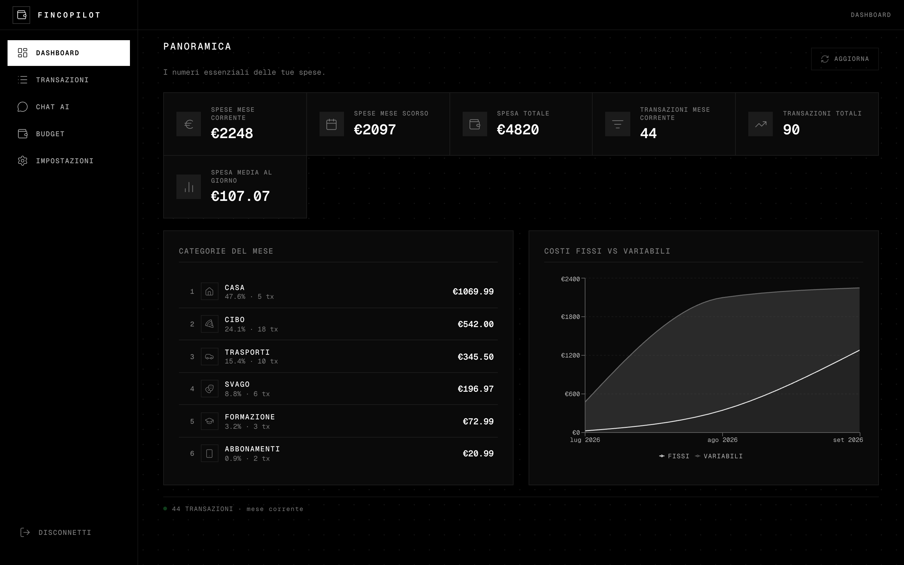
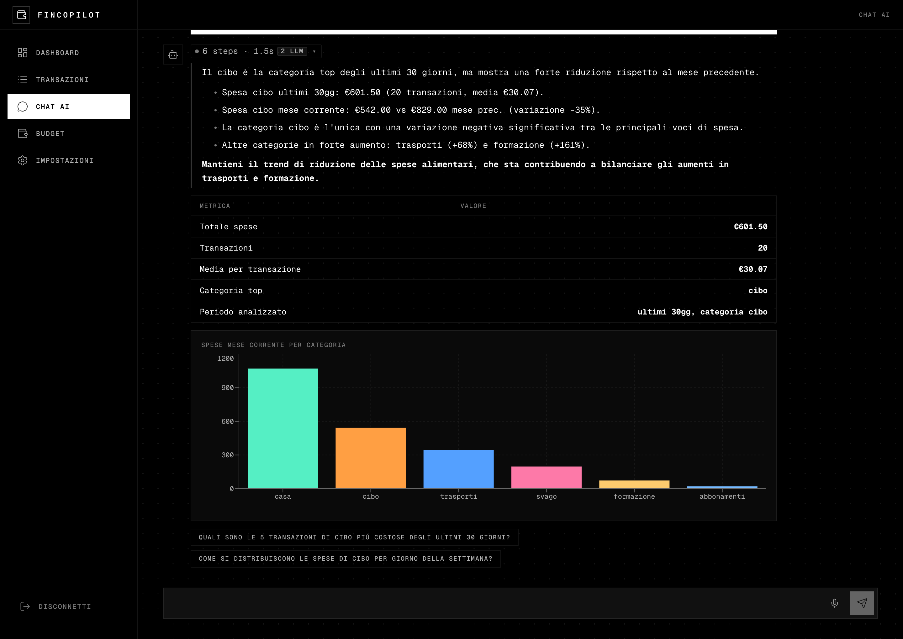
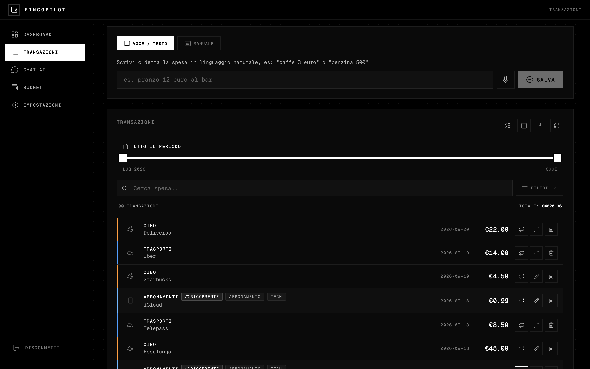
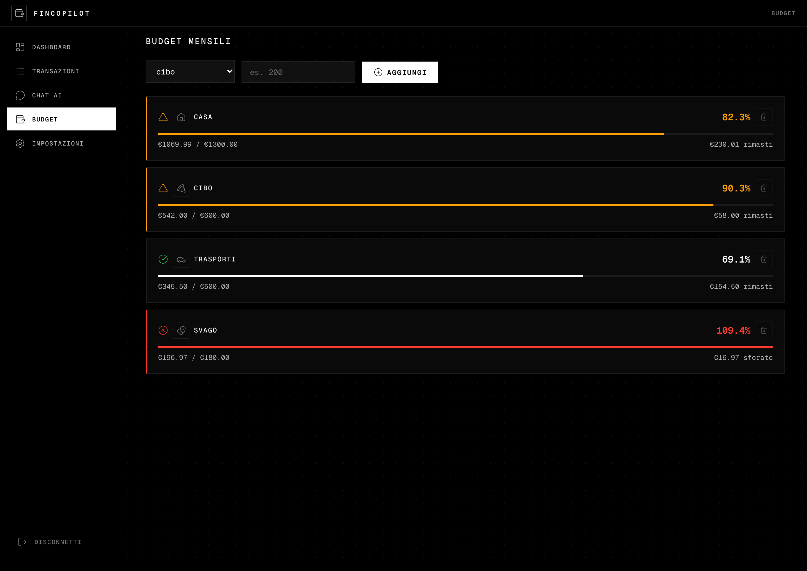
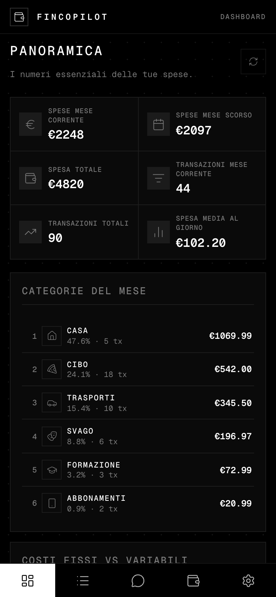
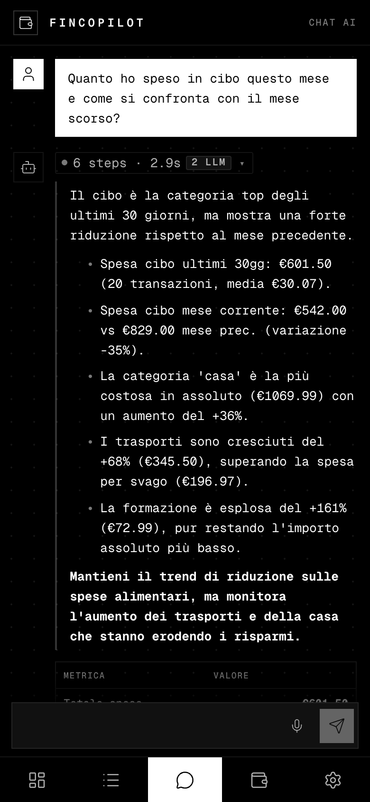
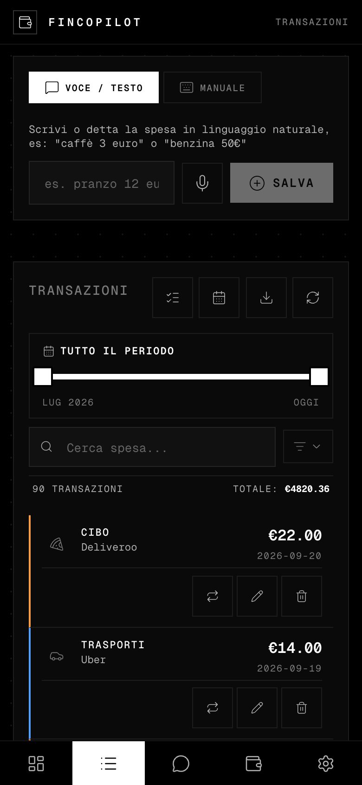
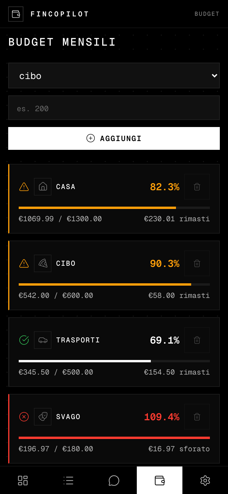

# FinCopilot


**Applicazione web per la gestione delle finanze personali, dotata di un assistente basato su intelligenza artificiale che risponde in italiano a domande sulle proprie spese.**

L'utente può registrare le spese scrivendole o dettandole (ad esempio "caffè 3 euro"), definire budget per categoria, importare l'estratto conto della propria banca e interrogare i propri dati in linguaggio naturale, ad esempio: *"Quanto ho speso in cibo questo mese rispetto al mese scorso?"*. La risposta è corredata da tabella e grafico.

**Demo online:** [copilot-finanziario-ten.vercel.app](https://copilot-finanziario-ten.vercel.app). È possibile registrarsi con email o con account Google. Il backend è ospitato su un piano gratuito di Render e può richiedere alcuni secondi per riattivarsi alla prima richiesta.



> Gli screenshot mostrano dati di esempio generati per la documentazione, non dati reali.

---

## Funzionalità

### Dashboard
Indicatori essenziali (spesa del mese corrente e del mese precedente, numero di transazioni, spesa media giornaliera), ripartizione per categoria e andamento di costi fissi e variabili.

### Chat AI
Interrogazione in linguaggio naturale delle proprie spese. Il modello non genera query SQL libere: seleziona una tra le funzioni analitiche predefinite (spese per categoria, confronto tra mesi, andamento, principali transazioni, abbonamenti, stato dei budget, simulazioni "what-if" e altre), che viene eseguita sui dati dell'utente. Il risultato è poi commentato in italiano e accompagnato da tabella, grafico e domande di approfondimento.



### Transazioni
Inserimento da testo o da voce, con riconoscimento automatico di importo e categoria, oppure in modalità manuale. Sono disponibili ricerca, filtri per categoria e periodo, contrassegno delle spese ricorrenti, eliminazione multipla ed esportazione in CSV.



### Budget
Definizione di un budget mensile per categoria, con stato su tre livelli: nella norma, in prossimità del limite, superato.



### Versione mobile
L'interfaccia è progettata anche per l'uso da telefono: barra di navigazione inferiore, disposizione su singola colonna e installazione come PWA.

<p align="center">
  
  
  
  
</p>

### Importazione da estratto conto
Caricamento di file CSV, Excel o PDF. L'applicazione riconosce le colonne (tramite euristiche e intelligenza artificiale), mostra un'anteprima modificabile dall'utente, esclude i duplicati rispetto alle transazioni già presenti e assegna automaticamente una categoria alle righe che ne sono prive.

### Ulteriori funzionalità
Report mensile in PDF con commento generato dall'intelligenza artificiale, categorie personalizzate, scelta del modello AI per singolo utente, accesso con email o con account Google, tema scuro e installazione come PWA.

---

## Architettura

```
 React (Vite, Zustand, Recharts)          Vercel
        |  JWT Supabase
        v
 FastAPI + SQLAlchemy                     Render
   |- middleware di autenticazione (verifica JWT)
   |- motore AI (router, funzione, interpretazione)  -->  Groq API (Qwen)
   `- motore di importazione (CSV / XLSX / PDF)
        |
        v
 PostgreSQL + Auth                        Supabase   (SQLite in sviluppo)
```

Scelte progettuali principali:

- **Multi-tenancy:** ogni tabella dispone di una colonna `user_id` (UUID di Supabase) e ogni endpoint filtra i dati per utente. Lo schema è versionato con Alembic.
- **Chat AI basata su funzioni predefinite:** il modello linguistico sceglie la funzione da eseguire e ne interpreta il risultato, ma non genera query. I parametri restituiti dal router sono validati e limitati a intervalli ammessi, pertanto un output malformato del modello non può produrre query arbitrarie. Le domande estranee all'ambito finanziario sono intercettate da un pre-filtro, senza alcuna chiamata al modello.
- **Determinismo:** temperatura pari a 0 e seed fisso sul router, output JSON forzato, limiti rigidi su lunghezza dell'input, cronologia, righe delle tabelle e punti dei grafici.
- **Importazione senza stato sul server:** gli endpoint `/import/preview` e `/import/commit` ricevono entrambi il file, per cui non è necessario conservare informazioni tra le due chiamate.

---

## Stack tecnologico

| Livello | Tecnologie |
|---|---|
| Backend | Python 3.11, FastAPI, SQLAlchemy, Alembic, pandas, pdfplumber, ReportLab |
| Intelligenza artificiale | Groq API (modelli Qwen) tramite client compatibile con OpenAI |
| Database e autenticazione | Supabase (PostgreSQL e Auth), SQLite in ambiente locale |
| Frontend | React 19, TypeScript, Vite, Zustand, Recharts, React Router |
| Distribuzione | Render (API), Vercel (frontend), GitHub Actions (controllo di disponibilità) |

---

## Esecuzione in ambiente locale

Sono richiesti Python 3.11 o superiore, Node 18 o superiore, una [chiave API di Groq](https://console.groq.com) e un progetto [Supabase](https://supabase.com); entrambi i servizi dispongono di un piano gratuito.

```bash
git clone https://github.com/Rbiagetti/Copilot-finanziario.git
cd Copilot-finanziario

# Backend
python -m venv venv
source venv/bin/activate          # Windows: venv\Scripts\activate
pip install -r requirements.txt
cp .env.example .env              # impostare GROQ_API_KEY e le credenziali Supabase
uvicorn backend.main:app --reload
# API:  http://localhost:8000    Documentazione: http://localhost:8000/docs

# Frontend (in un secondo terminale)
cd frontend
cp .env.example .env
npm install && npm run dev
# Applicazione:  http://localhost:5173
```

Le variabili d'ambiente sono descritte in `.env.example` (backend) e in `frontend/.env.example` (frontend).

**Dati di esempio.** Se `SUPABASE_URL` è vuoto, il backend non esegue l'autenticazione e utilizza un utente di sviluppo. In tale modalità è possibile caricare 90 transazioni di esempio con il comando:

```bash
python -m backend.tests.seed_test_data
```

Se invece l'autenticazione Supabase è attiva (come in produzione), i dati demo vanno associati al tuo `user_id` Supabase, altrimenti non li vedrai dopo il login:

```bash
SEED_USER_ID=<uuid-supabase> python -m backend.tests.seed_test_data
```

Per lavorare in locale senza scrivere sul database di produzione, imposta in `.env`:

```bash
DEV_DATABASE_URL=sqlite:///./data/fincopilot_dev.db
```

Questa variabile ha priorità su `DATABASE_URL` quando l'app non gira su Render. Se invece usi consapevolmente il DB di produzione anche in locale, imposta `ALLOW_PROD_DB_LOCAL=1` per silenziare l'avviso all'avvio. Il comando di seed rifiuta di scrivere su un database non SQLite, a meno che non venga impostato esplicitamente `ALLOW_PROD_SEED=1`.

---

## Test

```bash
# Test deterministici: routing AI, importazione, patrimonio (nessuna chiave API richiesta)
pytest backend/tests/test_ai_routing.py backend/tests/test_import_engine.py backend/tests/test_wealth.py backend/tests/test_wealth_http.py -v

# Backtest conversazionale della chat (esplicito: consuma token Groq)
RUN_LLM_TESTS=1 pytest backend/tests/test_chat_backtest.py -v -s
```

---

## Struttura del progetto

```
|- backend/
|  |- api/
|  |  |- models/          # schemi Pydantic
|  |  `- routes/          # router FastAPI (chat, transazioni, budget, importazione, report)
|  |- core/
|  |  |- ai_engine.py     # router, funzioni analitiche, controlli di sicurezza
|  |  |- import_engine.py # lettura CSV / XLSX / PDF e associazione delle colonne
|  |  `- database.py      # modelli SQLAlchemy
|  |- tests/
|  `- main.py
|- frontend/src/
|  |- components/         # una cartella per area (Dashboard, Chat, Budget, ...)
|  |- store/              # stato globale (Zustand)
|  |- styles/             # CSS suddiviso per area
|  `- api/                # client HTTP
|- alembic/               # migrazioni del database
|- docs/screenshots/      # immagini utilizzate in questo documento
`- render.yaml            # configurazione della distribuzione su Render
```

---

## Sviluppi previsti

- [x] Chat AI con funzioni analitiche predefinite
- [x] Budget per categoria
- [x] Report mensile in PDF
- [x] Importazione da estratto conto (CSV, Excel, PDF)
- [x] Supporto multiutente con Supabase Auth
- [x] Installazione come PWA
- [ ] Notifiche al superamento di un budget
- [ ] Importazione con formati specifici per le principali banche italiane

---

## Licenza

Distribuito con licenza MIT. Il testo completo è nel file [LICENSE](LICENSE).

## Autore

Roberto Biagetti, [GitHub](https://github.com/Rbiagetti)
